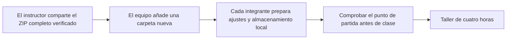

# Empezar la siguiente sesión de Loom

**Un ZIP completo. Una carpeta nueva por sesión. Preparación terminada antes de clase.**

| Sesión | Carpeta nueva de aplicación | Base suministrada | Ejercicios actuales | Almacenamiento local |
|---|---|---|---:|---|
| 01 | `session-01/` | Harness de agente controlado | 3 | SQLite predeterminado |
| 02 | `session-02/` | Referencia completa de la sesión 1 | 4 | SQLite predeterminado; PostgreSQL opcional |
| 03 | `session-03/` | Referencia completa de la sesión 2 | 4 | PostgreSQL independiente, por ejemplo `loom_session03` |

El equipo conserva el trabajo anterior. Cada ZIP nuevo aporta la base de referencia; las mejoras propias y el historial de datos no se transfieren automáticamente. Comparar o incorporar mejoras seleccionadas es opcional después de clase. Un ejercicio anterior pendiente no impide abrir el nuevo punto de partida.

Antes de clase, abre la carpeta de la sesión actual, instala las dependencias congeladas, crea su propio `.env.local`, migra y carga su propia base y ejecuta preflight, tipos, lint, pruebas y compilación. Solo deben fallar las pruebas de ejercicios previstas: **13 / 10 / 14** para las sesiones **01 / 02 / 03**.

Durante la clase, implementa los ejercicios actuales, ejecuta las comprobaciones y explica las evidencias. Utiliza [QUICKSTART.es.md](QUICKSTART.es.md) para los pasos concretos del equipo y de cada ordenador. [English version](SESSION-START.md).
