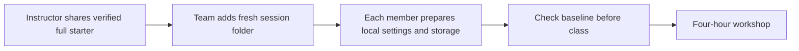

# Start the next Loom session

**One full starter. One fresh session folder. Setup finished before class.**

| Session | Fresh application folder | Supplied foundation | Current exercises | Local storage |
|---|---|---|---:|---|
| 01 | `session-01/` | Controlled agent harness | 3 | SQLite default |
| 02 | `session-02/` | Completed Session 1 reference | 4 | SQLite default; PostgreSQL optional |
| 03 | `session-03/` | Completed Session 2 reference | 4 | Separate PostgreSQL, e.g. `loom_session03` |

Your team keeps previous work. Each new starter supplies the reference foundation; learner improvements and database history do not transfer automatically. Comparing or carrying selected improvements forward is optional after class. An unfinished previous exercise does not prevent opening the new starter.

Before class, open the current session folder, install frozen dependencies, create its own `.env.local`, migrate and seed its own database, and run preflight, typecheck, lint, tests and build. Expect only the declared exercise failures: **13 / 10 / 14** for Sessions **01 / 02 / 03**.

During class, implement the current exercises, run checks and explain the evidence. Use [QUICKSTART.md](QUICKSTART.md) for the exact team and workstation steps. [Versión en español](SESSION-START.es.md).
