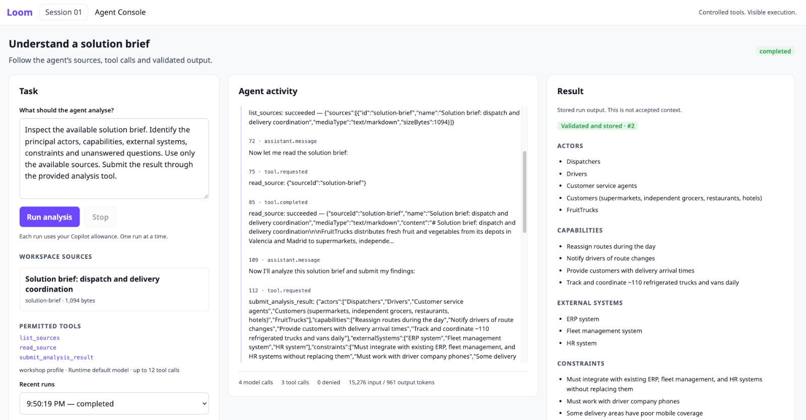

# Sesión 1 — Comprender los fundamentos de Loom

Esta lectura explica hacia dónde nos dirigimos, qué es Loom y por qué empezamos con una pequeña aplicación de agentes. Léela antes de la sesión para situarte y vuelve a ella después para relacionar los talleres con el conjunto del proyecto. Los pasos prácticos están en la [guía de talleres](WORKSHOP.md).

## ¿Qué queremos conseguir?

El objetivo del campus es desarrollar un equipo capaz de **diseñar e implementar una aplicación agéntica**: una aplicación en la que la IA pueda interpretar una tarea, elegir entre las acciones que se le han proporcionado, utilizar información y avanzar hacia un resultado.

Eso exige tomar distintos tipos de decisiones. El equipo necesita decidir qué debe hacer la IA, qué información debe recibir, qué acciones puede realizar, cómo se comprobará su trabajo y en qué puntos debe decidir una persona. También necesita convertir esas decisiones en software que funcione y que otros compañeros puedan comprender y mantener.

Puedes utilizar la IA como ayuda para escribir ese software. Aquí, nuestro tema principal es el comportamiento de la aplicación que construyes: cómo utiliza la IA mientras alguien trabaja con ella.

Practicaremos estas habilidades construyendo **Loom**. Loom proporciona al equipo un producto compartido en el que trabajar, de modo que las ideas se hagan visibles en algo que puedes ejecutar, examinar y mejorar. El resultado que buscamos es tanto una aplicación de referencia que funcione como un equipo capaz de tomar decisiones fundamentadas de diseño e implementación en otros proyectos.

## ¿Qué es Loom?

Loom es un espacio de trabajo de ingeniería que ayuda a un equipo a transformar el material de origen en una comprensión compartida y revisada de una solución de software.

Un proyecto suele empezar con una mezcla de documentos, conversaciones, peticiones del negocio e información de sistemas existentes. Estas fuentes pueden estar incompletas, utilizar palabras distintas para referirse a lo mismo o contradecirse. Antes de diseñar el software, el equipo necesita comprender quién lo utilizará, qué debe hacer, con qué sistemas debe trabajar y qué preguntas siguen sin respuesta.

Loom está pensado para ayudar en ese trabajo. Su IA puede leer material, identificar información útil, sugerir conexiones y señalar incertidumbres. Las personas revisan esas sugerencias y deciden qué pasa a formar parte de la comprensión acordada por el equipo. A medida que el producto se desarrolla, esa comprensión puede servir de base para la arquitectura, los documentos de ingeniería y el software, y ayudar al equipo a detectar qué requiere atención cuando algo cambia.

La conexión con el material original importa durante todo el proceso. Si Loom sugiere un requisito o un cambio de diseño, el equipo debe poder preguntar: **¿De dónde viene esto y por qué deberíamos aceptarlo?**

*Una maqueta de diseño del espacio de trabajo más amplio de Loom. Fíjate en la relación entre las fuentes, la representación compartida de la solución y las sugerencias pendientes de revisión. Esta imagen ilustra la dirección del producto; no es una captura de pantalla de la aplicación de la sesión 1.*

### ¿Dónde encaja FruitTrucks?

FruitTrucks es el ejemplo de negocio ficticio que utilizamos para que Loom trabaje sobre algo concreto. Distribuye productos frescos y quiere coordinar mejor las entregas. Su brief inicial de la solución describe problemas como los cambios de ruta que pasan desapercibidos y la necesidad de que atención al cliente llame a un conductor para saber cuándo llegará una entrega.

En esta historia hay dos aplicaciones distintas. **Loom es la aplicación de ingeniería que construimos. La aplicación de entregas es la solución que Loom nos ayuda a comprender y diseñar.** En la sesión 1, pedimos a nuestra pequeña aplicación de agentes que analice el brief de FruitTrucks. Estamos construyendo la infraestructura que permite realizar ese análisis, en lugar de construir un sistema de planificación de entregas.

## ¿Qué aporta la sesión 1?

La sesión 1 empieza con una tarea deliberadamente pequeña: leer un brief de solución disponible y producir un análisis organizado, respaldado por evidencias de ese brief. El análisis identifica personas y roles, capacidades necesarias, sistemas existentes, restricciones y preguntas abiertas.

La demostración terminada tiene una consola sencilla. Puedes darle una tarea, ver qué fuente y acciones están disponibles, seguir la actividad del agente y examinar el resultado guardado.

*La demostración terminada de la sesión 1. De izquierda a derecha puedes ver la tarea, el trabajo realizado y el resultado guardado por la aplicación. Este es el ejemplo completo del instructor; el punto de partida de los participantes contiene tres partes que se implementarán en los talleres.*

Esta consola muestra uno de los fundamentos de Loom. El modelo compartido, el proceso de revisión y el espacio de diseño del producto más amplio se apoyarán en la capacidad de realizar un análisis controlado y comprensible. Empezamos haciendo visible ese fundamento, antes de añadir el comportamiento más amplio del producto.

Al terminar la sesión 1, tu equipo debería disponer de una pequeña aplicación de agentes que funcione y ser capaz de explicar por qué se comporta así: qué puede leer, qué acciones puede realizar, cómo se comprueba y guarda un resultado y cómo se puede seguir su ejecución.

## ¿Qué entendemos por harness?

Piensa en pedir a un compañero que investigue una cuestión. Normalmente le darías un brief, acceso al material pertinente, un encargo bien delimitado y una forma de comunicar sus conclusiones. También le explicarías qué decisiones puede tomar y cuáles necesitan la aprobación de otra persona.

Una IA necesita una forma equivalente de organizar su trabajo. **El harness es el software que rodea a la IA, le proporciona su tarea, información, acciones disponibles y reglas de funcionamiento, y gestiona lo que ocurre durante y después del trabajo.**

En nuestra aplicación, eso incluye decidir qué fuente se puede leer, poner a disposición un conjunto reducido de acciones, comprobar las peticiones y los resultados, registrar lo ocurrido, guardar el resultado y permitir que se detenga una ejecución. Las instrucciones describen el comportamiento deseado; el software que las rodea realiza las comprobaciones y controla los cambios.

Una **herramienta**, en este contexto, es una acción que la aplicación pone a disposición del agente. Por ejemplo, una herramienta lee una fuente permitida y otra entrega un análisis para comprobarlo y guardarlo. La IA puede solicitar esas acciones; la aplicación decide si las lleva a cabo y cómo lo hace.

GitHub Copilot proporciona el software que gestiona la interacción de la IA con el modelo y la elección de herramientas dentro de la tarea. El código en el que trabajas proporciona la tarea, las herramientas y las reglas de la aplicación. Aprender cómo encajan estas responsabilidades es una parte central de la sesión 1.

## ¿Por qué estos tres talleres?

Los tres talleres recorren el camino desde la **información**, pasando por la **acción**, hasta un **resultado registrado**. Cada uno plantea una pregunta de ingeniería que seguirá siendo importante a medida que Loom crezca.

### Taller 1: ¿Qué puede leer el agente?

El primer taller completa el acceso a la fuente declarada. El agente debe solicitar una fuente disponible y la aplicación debe comprobar esa petición antes de leerla. La aplicación también recuerda qué fuente se ha leído realmente durante la ejecución.

Así queda clara la información en la que se basa el análisis. Ofrece al equipo una forma de explicar de dónde procede la información y de rechazar una petición que quede fuera del material permitido.

Para el futuro Loom, este es el comienzo de un acceso controlado al conocimiento del proyecto. Un espacio de trabajo más completo tendrá más fuentes, pero seguirá necesitando reglas claras sobre qué se puede leer y un registro del material utilizado.

### Taller 2: ¿Qué acciones puede utilizar el agente?

El segundo taller conecta Copilot con las herramientas e instrucciones que proporciona la aplicación. Los controles existentes limitan al agente a las acciones previstas para esta tarea.

Aquí la tarea ya se puede ejecutar: el agente puede descubrir la fuente, leerla e intentar entregar un análisis. El equipo puede observar las peticiones y comprender la función de cada acción. Una petición también puede rechazarse, con un motivo visible durante la ejecución.

Para el futuro Loom, la misma pregunta de diseño se aplica a acciones como interpretar material nuevo, proponer un cambio o comprobar el efecto de una modificación. Cada acción necesita un propósito y unos límites claros. Añadir una capacidad a un agente también significa diseñar el control que rodea a esa capacidad.

### Taller 3: ¿Cuándo se convierte un análisis en un resultado guardado?

El tercer taller completa el almacenamiento del análisis una vez superadas las comprobaciones existentes. Estas comprobaciones exigen un resultado organizado y evidencias que citen material leído durante la ejecución. La aplicación guarda el resultado asociado a esa ejecución e impide que un segundo envío correcto lo sustituya.

Un resultado guardado de esta forma puede volver a examinarse después de recargar la página. El equipo tiene algo concreto que revisar, más allá del mensaje final del agente.

Para el futuro Loom, esto proporciona una base para guardar propuestas y las evidencias que las respaldan. **Guardar un análisis comprobado en la sesión 1 no significa que una persona haya aprobado su significado.** La revisión y la aceptación humanas forman parte del producto más amplio hacia el que nos dirigimos. Un resultado puede tener la estructura esperada y citar una fuente real y, aun así, necesitar que alguien valore su interpretación.

## Cómo encajan las piezas

Considera esta pregunta: «¿Qué debería poder hacer la nueva aplicación de entregas de FruitTrucks?».

El agente descubre el brief disponible y pide leerlo. La aplicación comprueba que la fuente está permitida y proporciona su contenido. El agente interpreta el brief y después entrega un análisis con citas que lo respaldan. La aplicación comprueba el análisis y lo guarda si supera esas comprobaciones. La consola permite seguir el trabajo y examinar el resultado.

La IA aporta interpretación y decisiones dentro de la tarea. La aplicación controla el acceso, comprueba las peticiones y registra el resultado. Tu equipo diseña cómo se relacionan ambas partes.

En la versión más amplia de Loom, un análisis como este puede convertirse en la base de una propuesta que una persona revisa. La información aceptada puede contribuir después a la comprensión compartida de la solución por parte del equipo y al trabajo de ingeniería que viene a continuación. La sesión 1 nos proporciona un punto de partida controlado para ese recorrido más largo.

## Qué conviene llevarse de la sesión

Después de la sesión, utiliza la demostración para explicar tres cosas a un compañero: cómo obtiene su información el agente, cómo se controlan sus acciones y cómo su trabajo se convierte en un resultado que se puede examinar. Relaciona cada explicación con uno de los talleres.

También deberías poder situar ese resultado en el conjunto del proyecto: tu equipo está aprendiendo a construir aplicaciones agénticas; Loom es el producto con el que practica esas habilidades; y el harness es el fundamento que permite a la IA de Loom trabajar dentro de unas reglas que el equipo puede comprender y defender.

Para los ejercicios prácticos, continúa con [WORKSHOP.md](WORKSHOP.md). Para los conceptos y las comprobaciones más precisos, utiliza [THEORY.md](THEORY.md) y [VALIDATION.md](VALIDATION.md).

## Empezar la siguiente sesión

Cada sesión empieza con su ZIP inicial completo en una carpeta nueva. Incluye las implementaciones de referencia anteriores; conserva tu trabajo para compararlo. Las mejoras propias y el historial de datos no se transfieren automáticamente. Completa la preparación local antes de clase siguiendo [la guía breve de inicio](../../../SESSION-START.es.md) y [QUICKSTART](../../../QUICKSTART.es.md). Incorporar mejoras seleccionadas es opcional después de clase.
