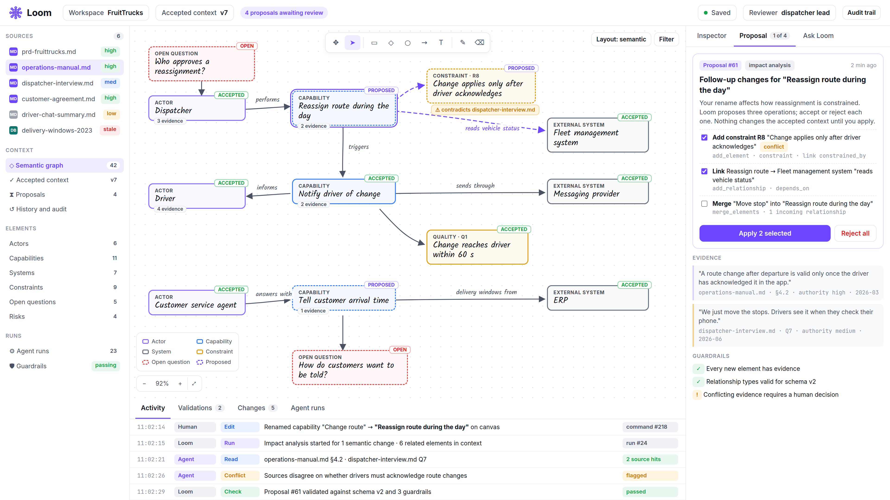

# Session 2 — Giving Loom a dependable working process

This reader explains why an agent needs a process around its work, what Session 2 adds to Loom, and how the workshops fit together. Read it before the session to get your bearings, and return to it afterwards to connect the exercises with the larger picture. The practical steps are in the [workshop guide](WORKSHOP.md).

## What are we trying to achieve?

The aim of the campus is to develop a team that can **design and implement an agentic application**: software in which AI can interpret a task, use information and choose from the actions the application provides.

That team needs to make decisions about the whole working arrangement. What may the AI do? How will its work be checked? What happens when something fails? Which decisions belong to a person? A useful application must answer these questions in behaviour that colleagues can observe, explain and maintain.

We practise those skills by building **Loom**. Each session contributes a working part of the product and a design lesson that you can use in other projects. Session 2 concentrates on keeping a piece of work understandable and recoverable from its beginning through to a human decision.

## What is Loom?

Loom is an engineering workspace that helps a team turn source material into a shared, reviewed understanding of a software solution.

A project usually starts with documents, conversations, business requests and information from existing systems. Loom's AI can help interpret this material, identify useful information and propose what deserves attention. People examine those suggestions and decide what the team accepts. As Loom develops, this reviewed understanding can support design, engineering documents and software, and help the team respond to changes.

For that to work, a suggestion needs more than a convincing explanation. The team needs to see the material behind it, know where it stands in the process, and understand who made the decision about it.

*A design mock-up of the larger Loom workspace. The suggestions awaiting review on the right help explain why Loom needs a dependable process around an agent's work. This illustrates the product direction; it is not a screenshot of the Session 2 application.*

### Where does FruitTrucks fit?

FruitTrucks is the fictional business we use throughout the campus. It distributes fresh produce and wants better coordination of deliveries. Its brief describes concerns such as missed route changes and customer service having to phone a driver for delivery information.

**Loom is the engineering application we build. The delivery application is the solution that Loom helps us understand and design.** In this session, Loom still analyses the FruitTrucks brief. We develop the process that carries that analysis through interruptions, repeated requests and human review.

## What does Session 2 contribute?

Session 1 established a controlled analysis: the agent could read an allowed brief, use supplied tools and submit a checked result. Session 2 places that work inside a **workflow**: a recorded process with a clear current state, a history and rules about what can happen next.

Imagine that an analysis has started and the application stops unexpectedly. When it starts again, the team should be able to find the same piece of work, see what happened and continue within its limits. If the agent fails, the application may try again a limited number of times. If a result is submitted twice, it should still produce one proposal. Once a proposal is ready, a person decides whether to accept or reject it.

The completed demonstration lets you inspect a workflow, its attempts and its recorded history. You can see a failed attempt followed by another attempt, return after an application restart, and review a saved proposal.

At the end of Session 2, your team should have a working process around the analysis and be able to explain how it survives interruption, avoids applying a result twice and keeps human acceptance explicit.

## What do we mean by a harness here?

The **harness** is the software around the AI that gives it its task, information, available actions and operating rules, and manages what happens during and after its work.

Think of asking a colleague to investigate a question. The investigation is one part of the job. Someone also needs to record the request, handle an interruption, decide when to ask for another attempt and send the findings to the right reviewer. The reviewer needs to know whether a decision has already been made.

An agent application needs that same distinction. GitHub Copilot manages the AI's interaction with the model and its choice of tools during an attempt. Loom manages the wider process: whether an attempt should begin, what happens after it fails, where a result is stored, and when it is ready for review.

These are sometimes called the **inner loop** and the **outer loop**. The inner loop carries out an agent task. The outer loop carries the application’s piece of work through its stages. Keeping them distinct gives your team a way to reason about failures without confusing an agent's message with the application's recorded state.

## Why these three workshop blocks?

The workshop has three teaching blocks and four pieces to implement. The middle block brings together repeated submissions and recovery after interruption. Together, they follow the path from **a valid process**, through **dependable progress**, to **a human decision**.

### Block 1: What may happen next?

The first block completes the rules for moving between workflow states. A new request cannot jump straight to acceptance, and a finished decision cannot simply be reversed. The application also checks that a person is acting on the version they actually saw.

This matters when two people look at the same proposal. If one has already decided, the other person's older screen must not quietly replace that decision. The recorded history should agree with the recorded state.

For the future Loom, these rules provide a foundation for proposal review and other engineering processes. Each stage needs a meaning that people can understand and limits that the software enforces.

### Block 2: How do we keep progress without doing the work twice?

The second block deals with two everyday problems: a result arrives again, or the application stops before the process finishes.

A repeated submission of the same analysis should return the existing result. A changed analysis presented as that same submission should be refused. This lets the application recognise work it has already recorded.

Recovery then looks at the saved process. An interrupted analysis may need a new attempt, subject to its original limit. A proposal that was already saved needs to move towards review. Restarting must not erase the earlier history or assume that every unfinished item needs the same treatment.

For the future Loom, these ideas will matter whenever an engineering task takes several steps or may be interrupted. The application needs enough recorded information to decide how to continue, with clear limits on automatic retries.

### Block 3: Who decides whether the proposal is accepted?

The third block completes the human accept and reject actions. The reviewer examines the proposal and its evidence, makes a decision and supplies a reason. The application checks that the decision is still valid and records it.

The agent can submit an analysis for review. Acceptance and rejection belong to a person, and the agent's supplied tools do not include those actions.

**A checked, saved proposal and an accepted proposal are different stages.** The checks establish that the submission meets the application's requirements. Human review judges what to do with it. Even an accepted Session 2 analysis is not yet the larger Loom product's connected model of the solution; that shared representation is developed later.

## How the pieces work together

Consider the request: “Analyse the FruitTrucks brief and identify the capabilities the new delivery application needs.”

Loom records a workflow and starts an agent attempt. The agent reads the allowed brief and tries to submit an analysis with supporting quotations. If the attempt fails before producing a proposal, Loom records the failure and may start another attempt within the agreed limit.

If the application stops after saving the proposal, recovery finds that saved work when it starts again. The proposal can reach review without being inserted a second time. A person then examines it and accepts or rejects it. An older, competing decision is refused rather than silently replacing the recorded one.

The workflow gives the team one piece of work to follow, even when several agent attempts were needed. Its durable history records the process and stored results; the live console's detailed agent trace is a separate view and may not survive a restart.

In the larger Loom, this dependable process will support reviewed changes to the team's understanding of a solution. Session 2 supplies a practical foundation for knowing what is pending, what has failed, what can continue and what a person has decided.

## What to take away

After the session, explain to a colleague how the application answers three questions: what may happen next, how work continues after repetition or interruption, and who can accept the result. Connect each answer to one of the workshop blocks.

Your team is learning to build agentic applications; Loom is the product used to practise those skills; and the harness now includes a durable process around the agent. That process makes progress, failure and human decisions visible enough to inspect and discuss.

For the practical exercises, continue with [WORKSHOP.md](WORKSHOP.md). For the more precise concepts and checks, use [THEORY.md](THEORY.md) and [VALIDATION.md](VALIDATION.md).

## Starting the next session

Each session starts from its supplied full starter in a fresh folder. Earlier reference implementations are included; keep your previous work for comparison. Learner improvements and database history do not transfer automatically. Complete local setup before class using [the session-start guide](../../../SESSION-START.md) and [QUICKSTART](../../../QUICKSTART.md). Carrying selected improvements forward is optional work after class.
