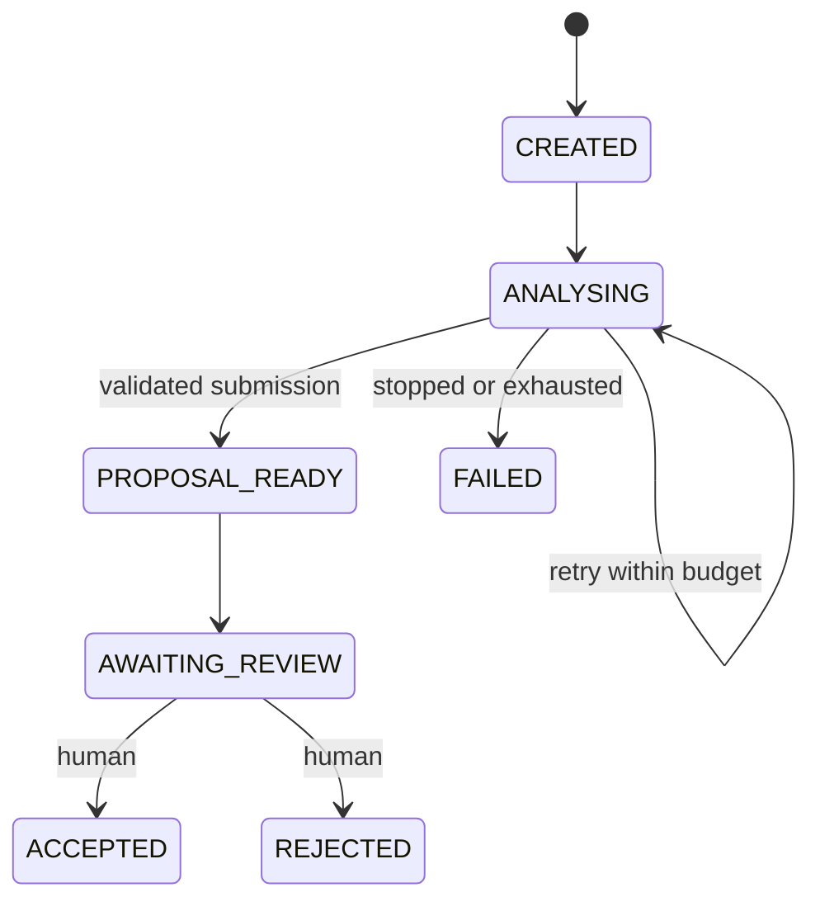

# Sesión 2 — Un bucle externo duradero

Empieza con [la lectura introductoria](INTRODUCTION.es.md) para situar esta sesión en el conjunto de Loom.

El harness de la Sesión 1 puede ejecutar un agente y almacenar un análisis. La Sesión 2 convierte esa invocación en un paso de un proceso que sobrevive a la parada de la API. Lee [el taller](WORKSHOP.md), [la validación](VALIDATION.md) y [el trabajo autónomo](SELF-STUDY.md) junto con esta explicación.

## Dos bucles, dos responsables

Copilot controla el bucle interno: interpreta la tarea, elige una herramienta, inspecciona su resultado y continúa o se detiene. Loom controla el bucle externo: inicia un intento, persiste una propuesta, espera a una persona y registra su decisión. Una respuesta satisfactoria de una herramienta significa que Loom ha almacenado el análisis; no significa que una persona lo haya aceptado.

| Información                                              | Responsable y duración                            |
| --------------------------------------------------------- | -------------------------------------------------- |
| Prompt e historial de conversación                       | Sesión de Copilot; una invocación                |
| Conjunto de fuentes leídas y presupuesto de herramientas | Loom; una invocación                              |
| Traza sin procesar del SDK                                | Memoria de Loom; se pierde al reiniciar el proceso |
| Resultado de la ejecución y análisis                    | SQLite o PostgreSQL; sobrevive al reinicio         |
| Estado del workflow, intentos, versión y auditoría      | SQLite o PostgreSQL; sobrevive al reinicio         |
| Aceptación o rechazo                                     | Acción humana, validada y persistida por Loom     |

## Estados y condiciones de transición

Una tabla explícita de transiciones rechaza las conexiones ilegales. La comprobación de versión rechaza una decisión tomada desde una pantalla desactualizada. La actualización y la inserción de auditoría comparten una transacción, por lo que un evento no puede describir una transición que no se haya confirmado. Los estados terminales no tienen transiciones de salida.

## Por qué una conversación con un agente no es una base de datos de workflows

El historial de conversación describe lo que se ha dicho. No puede imponer una transacción, identificar de forma única un resultado aplicado ni arbitrar entre dos revisores. Pedir al modelo que recuerde un estado no hace que ese estado sea duradero. Al reiniciar, Loom lee su base de datos e inicia una nueva invocación cuando es necesario; no reconstruye el estado de negocio a partir del texto del chat.

## Reintentos y checkpoints

Cada invocación tiene un nuevo ID de ejecución. El workflow tiene un ID estable y un número máximo de intentos, tres por defecto. Las invocaciones fallidas o incompletas se reintentan después de la pausa de un segundo del planificador. Una acción Stop explícita hace que el workflow falle sin reintento. Los detalles del fallo permanecen en el registro de ejecución y en el siguiente evento de reintento o fallo final.

Un fallo del proceso antes de reservar un intento deja el workflow en cola. Un fallo después de reservarlo consume ese intento. Un fallo después de confirmar una propuesta no requiere otra llamada al modelo: Loom pasa la propuesta almacenada a revisión. Un cierre ordenado detiene la planificación y deja el trabajo pendiente para el siguiente arranque. Este taller ejecuta un único proceso local de API por base de datos.

## Protección frente a duplicados

Loom vincula una clave de envío al workflow en su adaptador de almacenamiento de resultados. El modelo solo proporciona el análisis, no la clave. Guardar un análisis y entrar en el estado de propuesta es una operación atómica. Repetir el mismo contenido devuelve el mismo ID de resultado; cambiar el contenido con la misma clave falla. Un intento anterior no puede enviar un resultado después de que un intento nuevo tome el control. Esto garantiza una única aplicación de la propuesta, no exactamente una invocación al modelo.

## Límite de la revisión humana

Las únicas herramientas del agente siguen siendo `list_sources`, `read_source` y `submit_analysis_result`. La aceptación es una acción HTTP realizada desde la interfaz humana con una versión esperada y un motivo. El runtime deniega herramientas no registradas y permisos de shell. Los endpoints HTTP locales no autentican una identidad real; la identidad de producción y la planificación distribuida quedan fuera de esta sesión.

## Demostración de fallos

Un documento fuente no provoca de forma fiable una caída del proveedor. El servidor explícito de pruebas utiliza los mismos manejadores de herramientas, política, persistencia y worker del workflow con un ejecutor programado. Puede fallar, esperar una parada, enviar dos veces e intentar utilizar una herramienta de aceptación no registrada. Nunca contacta con Copilot. La aplicación habitual sigue utilizando Copilot y requiere los prerrequisitos normales.

## Cómo evoluciona hacia Loom

El workflow sobrevive a los intentos individuales de AgentRun. Su versión protege las transiciones del proceso y la revisión humana de un resultado de análisis. No es la ContextVersion del producto final. Las sesiones posteriores añaden propuestas semánticas vinculadas a un contexto base exacto, revisiones inmutables de elementos y aceptación atómica del contexto. La aceptación parcial requiere otra propuesta validada con las operaciones seleccionadas y sus dependencias. Esta sesión mantiene la revisión del resultado completo y un único worker local. Bun 1.4.0 sigue siendo el runtime de la aplicación.

## Empezar la siguiente sesión

Cada sesión empieza con su ZIP inicial completo en una carpeta nueva. Incluye las implementaciones de referencia anteriores; conserva tu trabajo para compararlo. Las mejoras propias y el historial de datos no se transfieren automáticamente. Completa la preparación local antes de clase siguiendo [la guía breve de inicio](../../../SESSION-START.es.md) y [QUICKSTART](../../../QUICKSTART.es.md). Incorporar mejoras seleccionadas es opcional después de clase.
