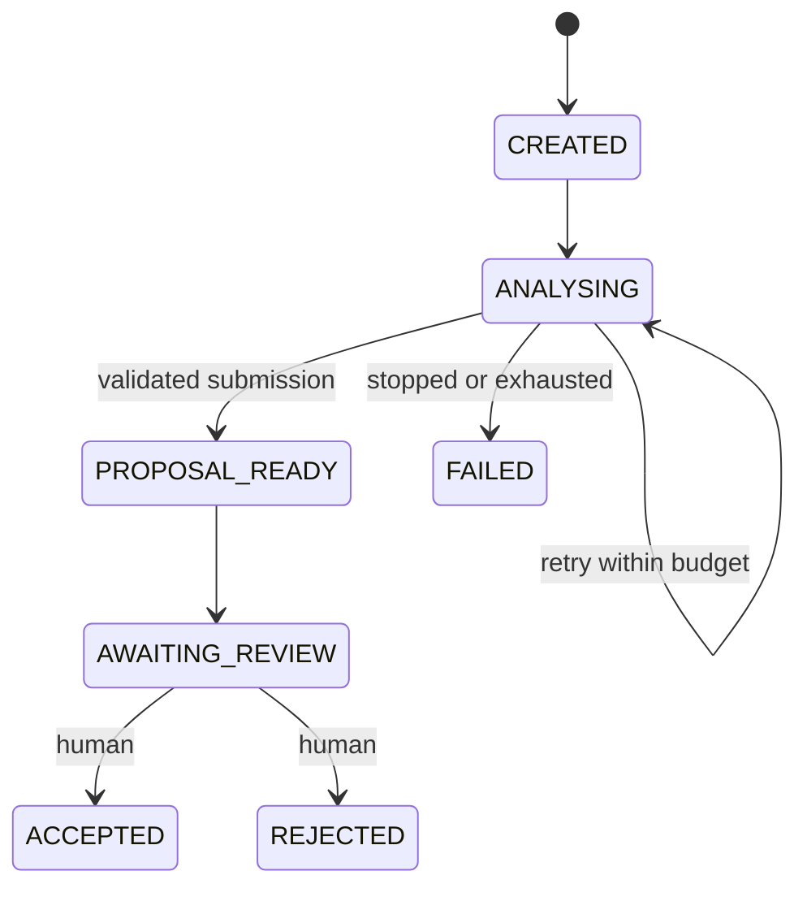

# Session 2 — A durable outer loop

Start with [the introductory reader](INTRODUCTION.md) for the purpose of this session and its relationship to Loom.

The Session 1 harness can run an agent and store an analysis. Session 2 makes that invocation one step in a process that survives the API stopping. Read [the workshop](WORKSHOP.md), [validation](VALIDATION.md) and [self-study](SELF-STUDY.md) alongside this explanation.

## Two loops, two owners

Copilot owns the inner loop: interpret the task, choose a tool, inspect its result and continue or stop. Loom owns the outer loop: start an attempt, persist a proposal, wait for a person and record their decision. A successful tool response means that Loom stored the analysis; it does not mean a person accepted it.

| Information | Owner and lifetime |
|---|---|
| Prompt and conversation history | Copilot session; one invocation |
| Source read set and tool budget | Loom; one invocation |
| Raw SDK trace | Loom memory; lost on process restart |
| Run outcome and result | SQLite or PostgreSQL; survives restart |
| Workflow state, attempts, version and audit | SQLite or PostgreSQL; survives restart |
| Acceptance or rejection | Human action, validated and persisted by Loom |

## States and guards

An explicit transition table rejects illegal edges. A version check rejects a decision made against an old screen. The update and audit insert share one transaction, so an event cannot describe a transition that never committed. Terminal states have no outgoing transitions.

## Why an agent conversation is not a workflow database

Conversation history describes what was said. It cannot enforce a transaction, uniquely identify an applied result, or arbitrate between two reviewers. Asking the model to remember a state does not make that state durable. On restart Loom reads its database and starts a fresh invocation when needed; it does not reconstruct business state from chat text.

## Retries and checkpoints

Each invocation has a new run ID. The workflow has a stable ID and a maximum attempt count, three by default. Failed or incomplete invocations retry after the worker's one-second scheduling delay. An explicit Stop fails the workflow without retry. Failure details remain in the run record and the next retry or final failure event.

A crash before claiming an attempt leaves the workflow queued. A crash after claiming it consumes that attempt. A crash after committing a proposal does not require another model call: Loom advances the stored proposal to review. Graceful shutdown stops scheduling and leaves pending work for the next startup. This workshop runs one local API process per database.

## Duplicate protection

Loom binds a submission key to the workflow in its result-store adapter. The model supplies only the analysis, not the key. Saving an analysis and entering the proposal state are atomic. Repeating the same payload returns the same result ID; changing the payload under the same key fails. An older attempt cannot submit after a newer attempt takes ownership. This gives one application of a proposal, not exactly one model invocation.

## Human review boundary

The only agent tools remain `list_sources`, `read_source` and `submit_analysis_result`. Acceptance is an HTTP action taken from the human interface with an expected version and a reason. The runtime denies unregistered tools and shell permissions. Local HTTP endpoints do not authenticate a real-world identity; production identity and distributed scheduling are outside this session.

## Failure demonstration

A source brief does not reliably cause a provider outage. The explicit fixture server uses the same tool handlers, policy, persistence and workflow worker with a scripted runner. It can fail, wait for a stop, submit twice and try an unregistered acceptance tool. It never contacts Copilot. The ordinary application continues to use Copilot and requires the normal prerequisites.

## How this grows into Loom

The workflow survives individual AgentRun attempts. Its version protects process transitions and human review of one analysis result. It is not the final product’s ContextVersion. Later sessions add semantic proposals tied to an exact base context, immutable element revisions and atomic context acceptance. Partial acceptance requires a separate validated proposal containing the selected operations and their dependencies. This session keeps whole-result review and one local worker. Bun 1.4.0 remains the application runtime.

## Starting the next session

Each session starts from its supplied full starter in a fresh folder. Earlier reference implementations are included; keep your previous work for comparison. Learner improvements and database history do not transfer automatically. Complete local setup before class using [the session-start guide](../../../SESSION-START.md) and [QUICKSTART](../../../QUICKSTART.md). Carrying selected improvements forward is optional work after class.
